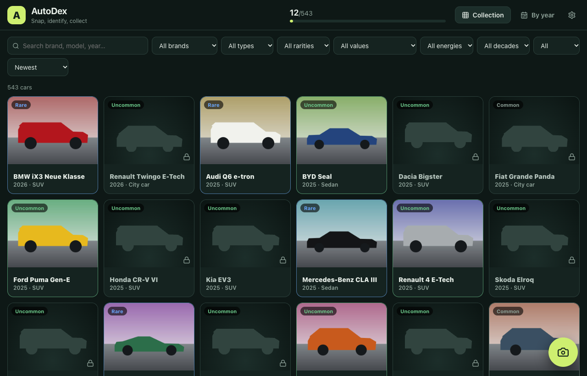

<p align="center"></p>

<h1 align="center">AutoDex</h1>

<p align="center"><b>Entdecken, fotografieren, sammeln: ein Autosammelspiel mit Bilderkennung direkt auf dem Gerät.</b></p>

<p align="center"> <a href="https://github.com/jeremdevgit/autodex/releases"></a> <a href="LICENSE"></a> <a href="https://github.com/jeremdevgit/autodex/actions/workflows/ci.yml"></a></p>

<p align="center"><a href="README.md">English</a> · <a href="README.fr.md">Français</a> · <a href="README.es.md">Español</a> · <b>Deutsch</b> · <a href="README.it.md">Italiano</a> · <a href="README.pt.md">Português</a> · <a href="README.zh.md">简体中文</a> · <a href="README.ja.md">日本語</a></p>

<p align="center"><a href="https://github.com/jeremdevgit/autodex/releases/latest"><b>⬇ Herunterladen</b></a></p>



Fotografiere ein Auto auf der Straße, die **KI auf dem Gerät** schlägt das Modell vor, und die Karte wird in deiner Sammlung freigeschaltet: **543 Autos von 1980 bis 2026, 74 Marken, fünf Seltenheitsstufen**. Kein Konto, keine Werbung, keine Cloud.

<p> </p>

## Auf einen Blick

| | |
|---|---|
| **Kategorie** | 🎮 Musik & Spiele |
| **Plattformen** | Windows · macOS · Linux · Smartphones (Web) |
| **Oberfläche** | 8 Sprachen (EN, FR, ES, DE, IT, PT, ZH, JA) |
| **Preis** | Kostenlos, quelloffen, ohne Werbung und Telemetrie |
| **Status** | Stabil |
| **Lizenz** | [GPL-3.0-or-later](LICENSE) |

## So wird gespielt

1. **Entdecke** ein Auto und fotografiere es (oder importiere ein Bild).
2. **Bestätige** das Modell aus den 5 Vorschlägen der KI – 196 Modelle werden erkannt, andere fügst du von Hand hinzu.
3. **Sammle**: Die Silhouette wird zu deinem Foto, mit 3D-Modell, Original-Lacknamen, Leistung, Antrieb und Richtwert.
4. **Vervollständige** die Sammlung nach Marke, Karosserie, Seltenheit, Jahrzehnt oder Jahr.


## Funktionen

| | |
|---|---|
| Bilderkennung | ResNet-50 läuft **lokal** in WebAssembly; nichts wird hochgeladen |
| Sortieren und filtern | Marke, Karosserie, Seltenheit, Wert, Antrieb, Jahrzehnt, vorhanden/fehlend; Ansicht „Nach Jahr“ |
| Sicherung | Vollständiger Export in eine JSON-Datei (mit Fotos); Import durch Zusammenführen oder Ersetzen |
| Smartphone ↔ Computer | Die Desktop-App stellt einen lokalen Server bereit, geschützt durch einen 8-stelligen Kopplungscode; Abgleich pro Foto |
| Selbst hosten | `npm run build && npm run server` oder das `Dockerfile` für ein NAS |

Die Daten beschreiben eine repräsentative Version; Werte sind Richtwerte.

## Installation

Hol dir die [neueste Version](https://github.com/jeremdevgit/autodex/releases/latest): Windows-`.exe` (pro Benutzer), universelles macOS-`.dmg`, Linux-`.deb` und `.AppImage`; prüfen mit `SHA256SUMS.txt`. Die Installer sind nicht kostenpflichtig signiert (SmartScreen kann nachfragen; unter macOS beim ersten Mal Rechtsklick › **Öffnen**).

**Auf dem Smartphone** musst du nichts installieren: Starte den Server in der Desktop-App (*Einstellungen › Mobiler Server*), öffne die angezeigte Adresse im selben WLAN und lege sie auf den Startbildschirm.

## Datenschutz

Keine Telemetrie, kein Konto, keine externen Anfragen: Modell, Schriften und Laufzeit sind enthalten. Fotos bleiben in der App und verlassen das Gerät nur beim Export oder Abgleich. Der Sync-Server akzeptiert nur geprüfte Daten, sperrt eine Adresse nach 10 falschen Codes und ist fürs Heimnetz gedacht – vor einer Freigabe ins Internet HTTPS davorschalten.

## Selbst bauen

```sh
# Node.js 20+, Rust stable und die Tauri-Voraussetzungen
npm ci
npm run dev              # Web-Version auf http://localhost:5173
npm test
npm run desktop:build    # Desktop-Installer
docker build -t autodex . && docker run -p 4174:4174 -v autodex-data:/data autodex
```

Servervariablen: `PORT`, `HOST`, `AUTODEX_DATA_DIR`; `AUTODEX_SERVER_PORT=4174` startet den Server der Desktop-App beim Start. Änderungen: [CHANGELOG.md](CHANGELOG.md).

## Lizenz

GPL-3.0-or-later – siehe [LICENSE](LICENSE). Danksagungen für Modell und Bibliotheken: [THIRD_PARTY.md](THIRD_PARTY.md). AutoDex ist mit keinem Autohersteller verbunden; Marken- und Modellnamen gehören ihren Inhabern.

---

Eine Sicherheitslücke gefunden? Bitte privat melden (siehe [SECURITY.md](SECURITY.md)), nicht in einem öffentlichen Issue.

## Weitere freie Software von jeremdevgit

Alle kostenlos, quelloffen und werbefrei.

**🛠️ System & Hardware** — [Boîte à outils](https://github.com/jeremdevgit/boite-a-outils) · [rJb](https://github.com/jeremdevgit/rjb) · [LJ Hub](https://github.com/jeremdevgit/lj-hub) · [Decklight](https://github.com/jeremdevgit/decklight)

**📒 Produktivität & Daten** — [Carnet de notes](https://github.com/jeremdevgit/carnet-rust) · [JMeca](https://github.com/jeremdevgit/jmeca) · [Suite Libre](https://jeremdevgit.github.io/suite-libre/)

**🎮 Musik & Spiele** — [Pomme](https://github.com/jeremdevgit/pomme) · [Ludothèque](https://github.com/jeremdevgit/ludotheque) · [Batailles de France](https://github.com/jeremdevgit/batailles-de-france)
