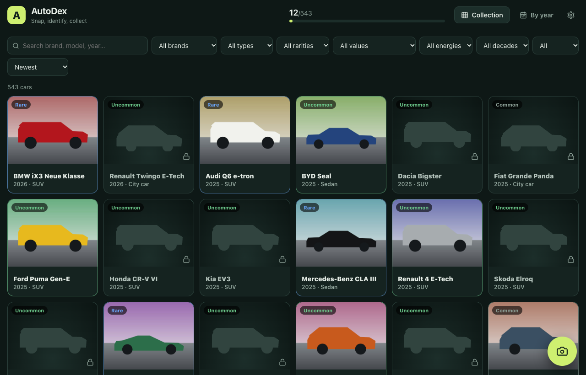
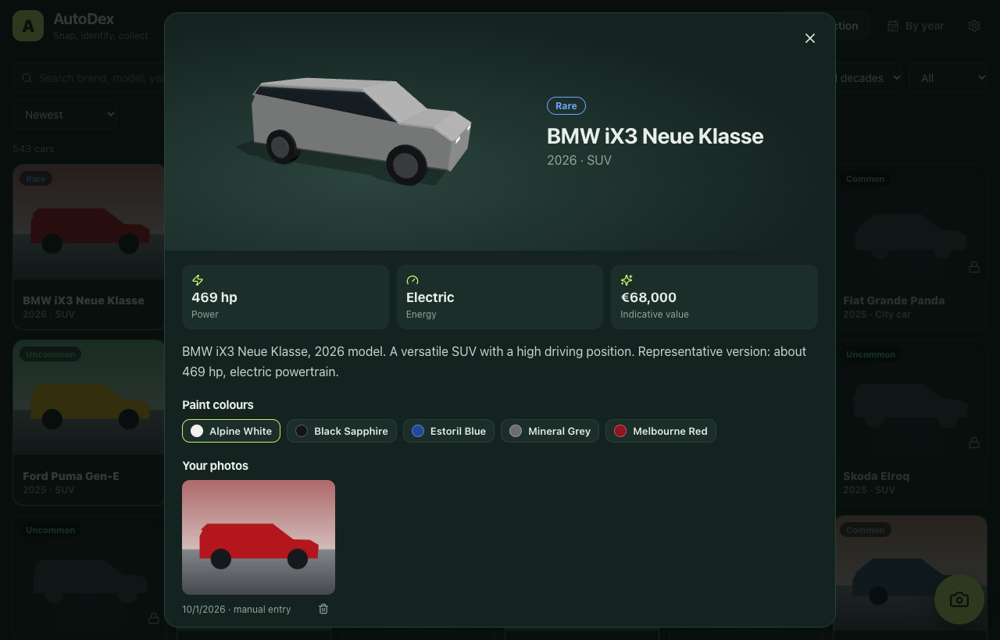
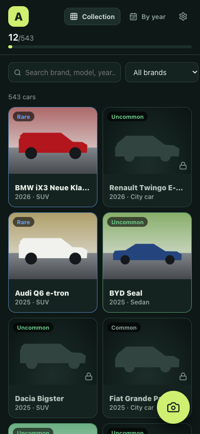

# AutoDex

[](https://github.com/jeremdevgit/autodex/actions/workflows/ci.yml) [](https://github.com/jeremdevgit/autodex/actions/workflows/codeql.yml) [](LICENSE) [](https://github.com/jeremdevgit/autodex/releases)

[English](README.md) · [Français](README.fr.md) · [**Español**](README.es.md)

**Encuéntralo, fotografíalo, colecciónalo.** Haz una foto a un coche por la calle: la IA, que funciona en tu dispositivo, propone el modelo y la carta se desbloquea en tu colección. 543 coches de 1980 a 2026, 74 marcas, cinco niveles de rareza. Sin cuenta, sin anuncios, sin nube: tus fotos se quedan en tus dispositivos.

## Descargar

Última versión en la [página de versiones](https://github.com/jeremdevgit/autodex/releases): instalador `.exe` para Windows (por usuario), `.dmg` universal para macOS (Apple Silicon e Intel), `.deb` y `.AppImage` para Linux. Comprueba los archivos con `SHA256SUMS.txt`. Los instaladores no están firmados con un certificado de pago: Windows SmartScreen puede pedir confirmación y, en macOS, abre la app la primera vez con clic derecho → **Abrir**.

En el **móvil** no hay que instalar nada: inicia el servidor desde la app de escritorio (Ajustes → Servidor móvil) y abre la dirección que muestra en el navegador del móvil, en la misma Wi-Fi. Puedes añadirla a la pantalla de inicio.

## Capturas

Datos de demostración con imágenes sintéticas, capturados desde la interfaz real.



<p> </p>

## Funciones

- **Reconocimiento por foto** con un modelo ResNet-50 ejecutado **en local** (WebAssembly, sin envíos): cinco propuestas con su confianza; tú confirmas. 196 modelos reconocibles; el resto se añade a mano y se marca como no verificado por la IA.
- **Colección** de 543 coches (1980–2026): silueta bloqueada hasta capturarlo, luego tus fotos, un modelo 3D giratorio, nombres reales de colores de fábrica, potencia, energía y valor orientativo.
- **Filtros y orden**: marca, carrocería, rareza, valor, energía, década, conseguido/pendiente; vista por año.
- **Copia de seguridad** completa en un archivo JSON (con fotos); importación por fusión o sustitución.
- **Sincronización móvil ↔ ordenador** con un servidor local protegido por un código de emparejamiento de 8 caracteres.
- **Autoalojamiento**: `npm run build && npm run server` o el `Dockerfile`.
- **Idiomas**: Français, English, Español, Deutsch, Italiano, Português, 简体中文, 日本語.

## Compilación

Requisitos: Node.js 20+, Rust estable y los [requisitos de Tauri](https://tauri.app/start/prerequisites/).

```sh
npm ci
npm run dev            # versión web en http://localhost:5173
npm test               # pruebas unitarias
npm run desktop:build  # instaladores de escritorio
```

Sin telemetría, sin cuenta y sin peticiones externas. El servidor de sincronización está pensado para la red doméstica; no lo expongas a Internet sin HTTPS delante. Ver [SECURITY.md](SECURITY.md).

## Proyecto

Mantenedor: [jeremdevgit](https://github.com/jeremdevgit). Licencia GPL-3.0-or-later. Créditos: [THIRD_PARTY.md](THIRD_PARTY.md). Cambios: [CHANGELOG.md](CHANGELOG.md). AutoDex no está afiliado a ningún fabricante.

## Mis programas

Todos libres y gratuitos — [github.com/jeremdevgit](https://github.com/jeremdevgit):

| Programa | Plataforma | En resumen |
|---|---|---|
| [Boîte à outils](https://github.com/jeremdevgit/boite-a-outils) | Windows, macOS | Mantenimiento del ordenador y búsqueda de archivos |
| [Carnet de notes](https://github.com/jeremdevgit/carnet-rust) | Windows | Notas cifradas y sincronización experimental |
| [JMeca](https://github.com/jeremdevgit/jmeca) | Windows, macOS, Linux | Mantenimiento de vehículos cifrado |
| [Decklight](https://github.com/jeremdevgit/decklight) | Windows, macOS, Linux | Stream Deck virtual con control USB |
| [LJ Hub](https://github.com/jeremdevgit/lj-hub) | Windows, macOS, Linux | Gestor de perfiles de periféricos Logitech |
| [Pomme](https://github.com/jeremdevgit/pomme) | Windows | Apple Music y música local |
| [rJb](https://github.com/jeremdevgit/rjb) | Windows | Iluminación RGB |
| [Ludothèque](https://github.com/jeremdevgit/ludotheque) | macOS | Biblioteca y lanzador de juegos |
| [Suite Libre](https://github.com/jeremdevgit/suite-libre) | Navegador | Seis herramientas sin cuenta |
| [Batailles de France](https://github.com/jeremdevgit/batailles-de-france) | Navegador | Juego de estrategia en tiempo real |
