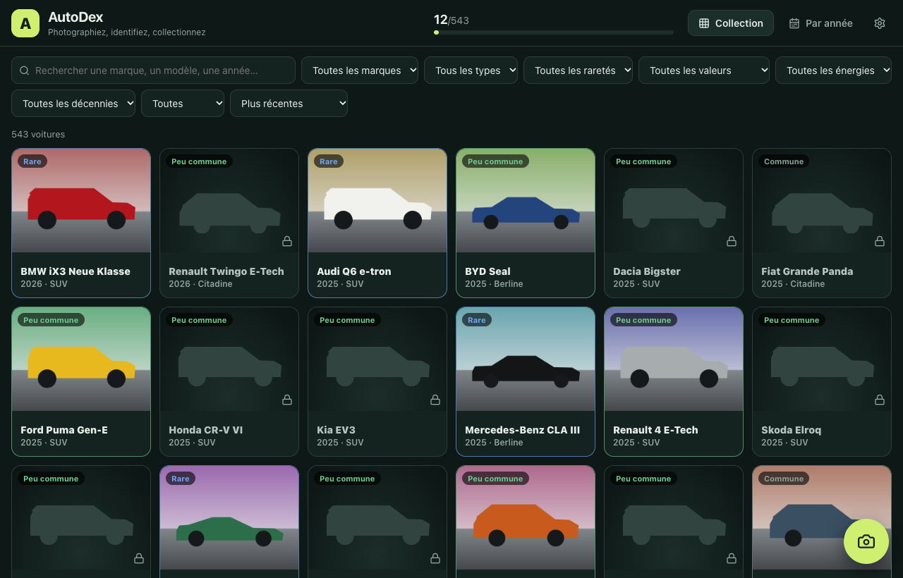
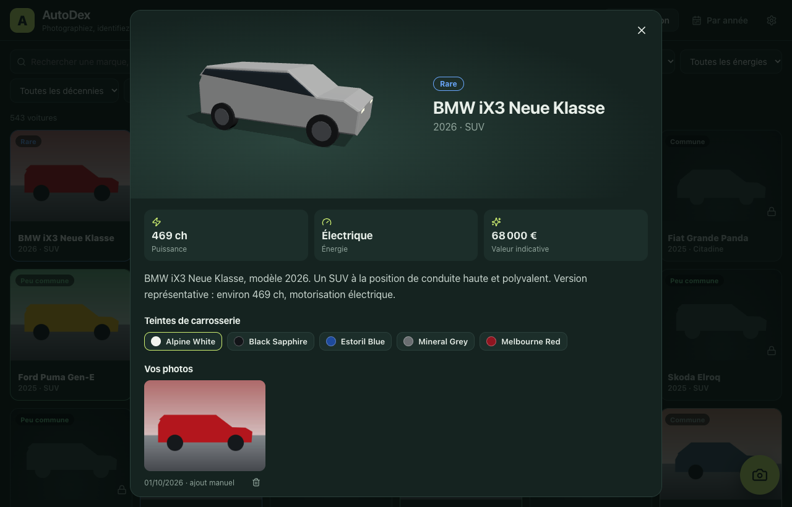
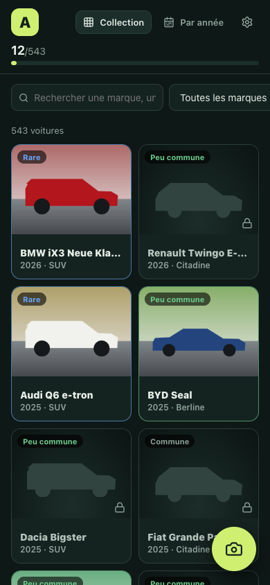
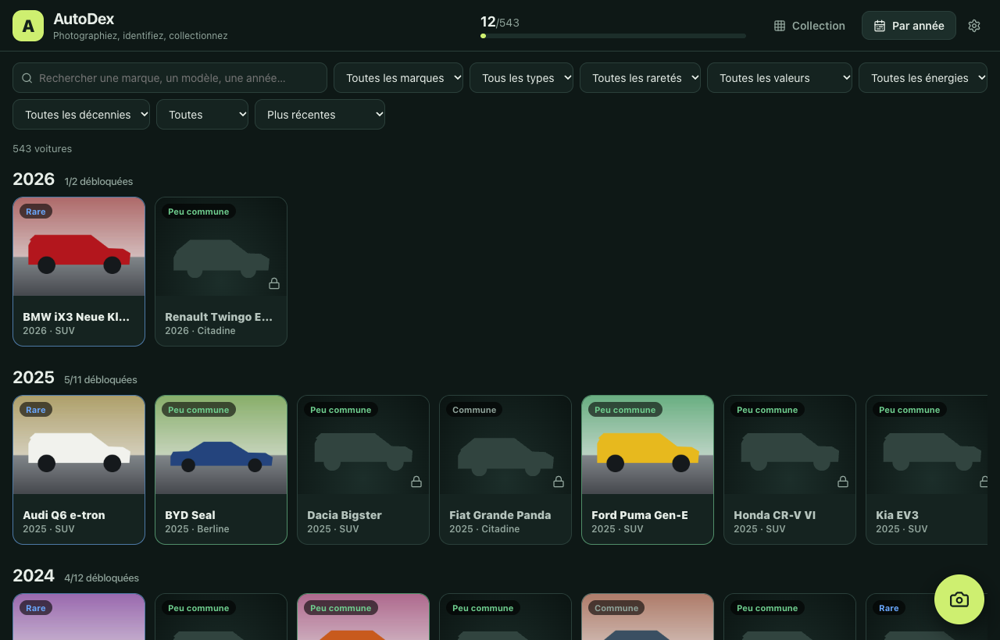

<p align="center"></p>

<h1 align="center">AutoDex</h1>

<p align="center"><b>Repérer, photographier, collectionner : un jeu de collection de voitures avec reconnaissance photo sur l'appareil.</b></p>

<p align="center"> <a href="https://github.com/jeremdevgit/autodex/releases"></a> <a href="LICENSE"></a> <a href="https://github.com/jeremdevgit/autodex/actions/workflows/ci.yml"></a></p>

<p align="center"><a href="README.md">English</a> · <b>Français</b> · <a href="README.es.md">Español</a> · <a href="README.de.md">Deutsch</a> · <a href="README.it.md">Italiano</a> · <a href="README.pt.md">Português</a> · <a href="README.zh.md">简体中文</a> · <a href="README.ja.md">日本語</a></p>

<p align="center"><a href="https://github.com/jeremdevgit/autodex/releases/latest"><b>⬇ Télécharger</b></a></p>



Prenez en photo une voiture dans la rue, l'**IA embarquée** propose le modèle, et la carte se débloque dans votre collection : **543 voitures de 1980 à 2026, 74 marques, cinq niveaux de rareté**. Ni compte, ni publicité, ni cloud.

<p> </p>

## En bref

| | |
|---|---|
| **Catégorie** | 🎮 Musique et jeux |
| **Plateformes** | Windows · macOS · Linux · téléphones (web) |
| **Interface** | 8 langues (EN, FR, ES, DE, IT, PT, ZH, JA) |
| **Prix** | Gratuit, open source, sans publicité ni télémétrie |
| **État** | Stable |
| **Licence** | [GPL-3.0-or-later](LICENSE) |

## Comment jouer

1. **Repérez** une voiture et prenez-la en photo (ou importez une image).
2. **Confirmez** le modèle parmi les 5 propositions de l'IA — 196 modèles sont reconnus ; les autres s'ajoutent à la main.
3. **Collectionnez** : la silhouette devient votre photo, avec un modèle 3D, les noms de teintes d'origine, la puissance, l'énergie et une valeur indicative.
4. **Complétez** la collection par marque, carrosserie, rareté, décennie ou année.



## Fonctions

| | |
|---|---|
| Reconnaissance photo | ResNet-50 exécuté **localement** en WebAssembly ; rien n'est envoyé |
| Tri et filtres | Marque, carrosserie, rareté, valeur, énergie, décennie, possédées/manquantes ; vue « Par année » |
| Sauvegarde | Export complet dans un fichier JSON (photos comprises) ; import en fusion ou en remplacement |
| Téléphone ↔ ordinateur | L'application de bureau héberge un serveur local protégé par un code d'appairage de 8 caractères ; fusion photo par photo |
| Auto-hébergement | `npm run build && npm run server`, ou le `Dockerfile` pour un NAS |

Les caractéristiques décrivent une version représentative ; les valeurs sont indicatives.

## Installer

Récupérez la [dernière version](https://github.com/jeremdevgit/autodex/releases/latest) : `.exe` Windows (par utilisateur), `.dmg` universel macOS, `.deb` et `.AppImage` Linux ; vérifiez avec `SHA256SUMS.txt`. Les installateurs ne sont pas signés par un certificat payant (SmartScreen peut demander confirmation ; sous macOS, clic droit › **Ouvrir** la première fois).

**Sur téléphone**, rien à installer : démarrez le serveur dans l'application de bureau (*Réglages › Serveur mobile*), ouvrez l'adresse affichée sur le même Wi-Fi et ajoutez-la à l'écran d'accueil.

## Confidentialité

Ni télémétrie, ni compte, ni requête externe : le modèle, les polices et le moteur sont inclus. Les photos restent dans l'application et ne quittent l'appareil que si vous exportez ou synchronisez. Le serveur de synchro n'accepte que des données validées, bloque une adresse après 10 codes erronés et est prévu pour le réseau de la maison — placez-le derrière HTTPS avant de l'exposer.

## Compiler

```sh
# Node.js 20+, Rust stable et les prérequis Tauri
npm ci
npm run dev              # version web sur http://localhost:5173
npm test
npm run desktop:build    # installateurs de bureau
docker build -t autodex . && docker run -p 4174:4174 -v autodex-data:/data autodex
```

Variables du serveur : `PORT`, `HOST`, `AUTODEX_DATA_DIR` ; `AUTODEX_SERVER_PORT=4174` démarre le serveur de l'application de bureau au lancement. Changements : [CHANGELOG.md](CHANGELOG.md).

## Licence

GPL-3.0-or-later — voir [LICENSE](LICENSE). Crédits du modèle et des bibliothèques : [THIRD_PARTY.md](THIRD_PARTY.md). AutoDex n'est affilié à aucun constructeur ; les noms de marques et de modèles appartiennent à leurs propriétaires.

---

Une faille de sécurité ? Signalez-la en privé (voir [SECURITY.md](SECURITY.md)) plutôt que dans un ticket public.

## Mes autres logiciels libres

Tous gratuits, open source et sans publicité.

**🛠️ Système et matériel** — [Boîte à outils](https://github.com/jeremdevgit/boite-a-outils) · [rJb](https://github.com/jeremdevgit/rjb) · [LJ Hub](https://github.com/jeremdevgit/lj-hub) · [Decklight](https://github.com/jeremdevgit/decklight)

**📒 Productivité et données** — [Carnet de notes](https://github.com/jeremdevgit/carnet-rust) · [JMeca](https://github.com/jeremdevgit/jmeca) · [Suite Libre](https://jeremdevgit.github.io/suite-libre/)

**🎮 Musique et jeux** — [Pomme](https://github.com/jeremdevgit/pomme) · [Ludothèque](https://github.com/jeremdevgit/ludotheque) · [Batailles de France](https://github.com/jeremdevgit/batailles-de-france)
