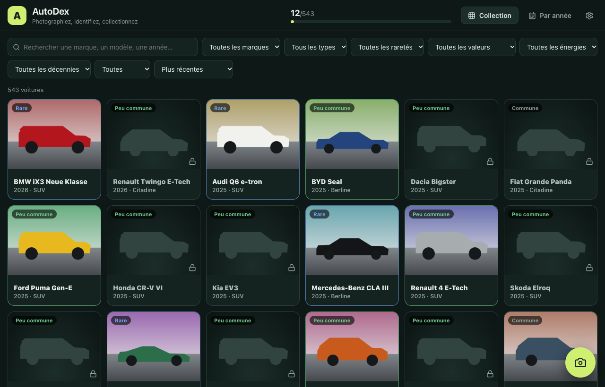
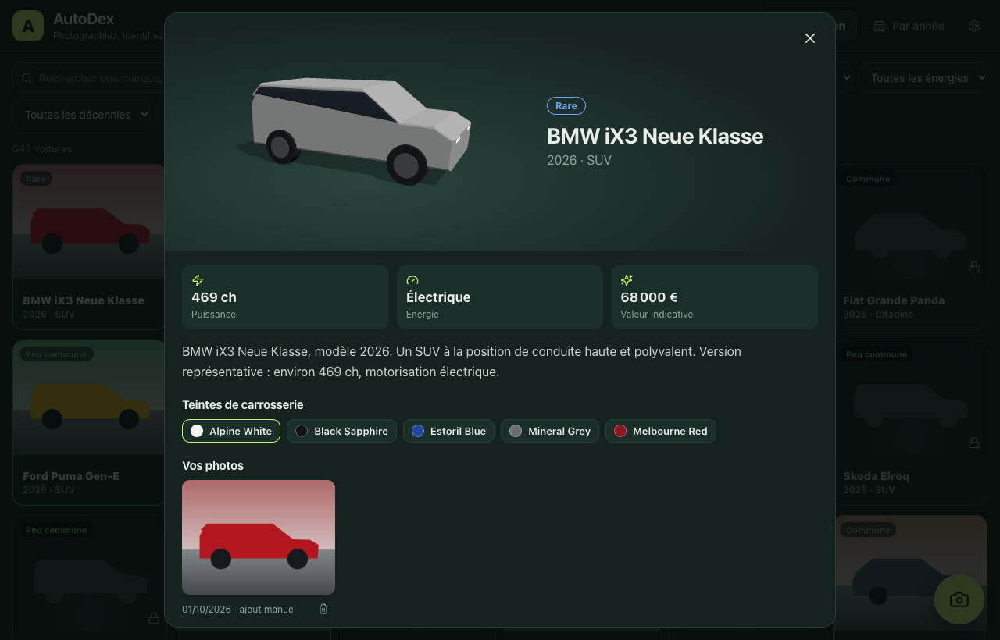
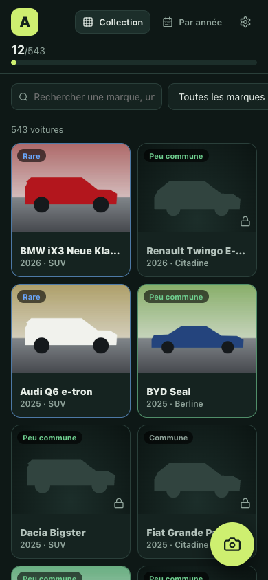
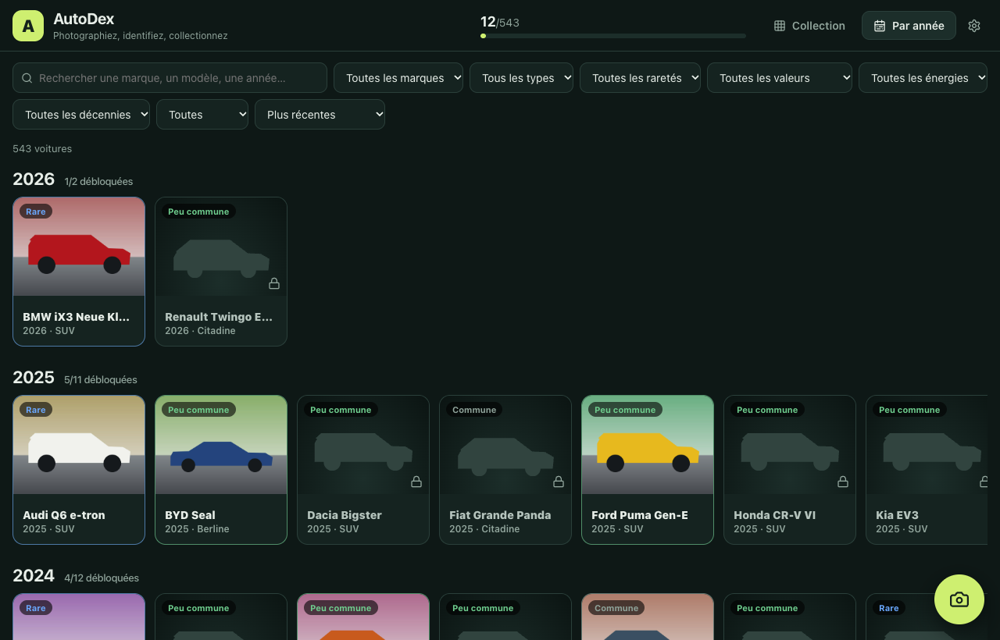

# AutoDex

[](https://github.com/jeremdevgit/autodex/actions/workflows/ci.yml) [](https://github.com/jeremdevgit/autodex/actions/workflows/codeql.yml) [](LICENSE) [](https://github.com/jeremdevgit/autodex/releases)

[English](README.md) · [**Français**](README.fr.md) · [Español](README.es.md)

**Repérez, photographiez, collectionnez.** Prenez en photo une voiture dans la rue : l'IA, qui tourne sur votre appareil, propose le modèle et la carte se débloque dans votre collection. 543 voitures de 1980 à 2026, 74 marques, cinq niveaux de rareté. Sans compte, sans publicité, sans cloud : vos photos restent sur vos appareils.

## Télécharger

Dernière version sur la [page des versions](https://github.com/jeremdevgit/autodex/releases) : installateur Windows `.exe` (par utilisateur), `.dmg` macOS universel (Apple Silicon et Intel), `.deb` et `.AppImage` pour Linux. Vérifiez les fichiers avec `SHA256SUMS.txt`. Les installateurs ne sont pas signés avec un certificat payant : Windows SmartScreen peut demander une confirmation et, sur macOS, ouvrez l'app la première fois par clic droit → **Ouvrir**.

Sur **téléphone**, rien à installer : démarrez le serveur depuis l'app de bureau (Réglages → Serveur mobile), puis ouvrez l'adresse affichée dans le navigateur du téléphone, sur le même Wi-Fi. Vous pouvez l'ajouter à l'écran d'accueil.

## Captures

Données de démonstration avec des images de synthèse, capturées depuis la vraie interface.



<p> </p>



## Fonctions

| | |
|---|---|
| Reconnaissance photo | Modèle ResNet-50 exécuté **en local** (WebAssembly, aucun envoi). Cinq propositions avec leur indice de confiance ; vous confirmez la bonne voiture. 196 modèles sont reconnaissables ; les autres s'ajoutent à la main et sont signalés comme non vérifiés par l'IA. |
| Collection | 543 voitures (1980–2026) : silhouette verrouillée tant qu'elle n'est pas capturée, puis vos photos, un modèle 3D orientable, les vrais noms de teintes d'usine, la puissance, l'énergie et une valeur indicative. |
| Tri et filtres | Marque, carrosserie, rareté, tranche de valeur, énergie, décennie, possédée/manquante ; tri par année, rareté, valeur, puissance ou nom. Vue « Par année ». |
| Sauvegarde | Export complet dans un seul fichier JSON (photos comprises) ; import en fusion ou en remplacement. |
| Synchro téléphone ↔ ordinateur | L'app de bureau intègre un serveur local protégé par un code de jumelage de 8 caractères. La fusion se fait photo par photo (la modification la plus récente gagne, les suppressions sont conservées). |
| Auto-hébergement | `npm run build && npm run server` ou le `Dockerfile` pour un NAS. |
| Langues | Français, English, Español, Deutsch, Italiano, Português, 简体中文, 日本語. |

Les caractéristiques sont celles d'une version représentative et les valeurs sont indicatives : elles varient selon la finition, le marché et l'état.

## Compilation

Prérequis : Node.js 20+, Rust stable et les [prérequis Tauri](https://tauri.app/start/prerequisites/) de votre système.

```sh
npm ci
npm run dev            # version web sur http://localhost:5173
npm test               # tests unitaires
npm run desktop:build  # installateurs de bureau
```

Serveur auto-hébergé : `npm run build && npm run server` (variables `PORT`, `HOST`, `AUTODEX_DATA_DIR`). Avec Docker : `docker build -t autodex . && docker run -p 4174:4174 -v autodex-data:/data autodex`. Le code de jumelage s'affiche au démarrage et est enregistré dans le dossier de données. L'app de bureau peut aussi lancer son serveur au démarrage avec `AUTODEX_SERVER_PORT=4174`.

## Vie privée et sécurité

Aucune télémétrie, aucun compte, aucune requête externe : le modèle d'IA et le moteur d'exécution sont inclus. Les photos sont stockées dans l'app (IndexedDB) et ne quittent l'appareil que si vous les exportez ou les synchronisez. Le serveur de synchro n'accepte que des données validées (photos JPEG/PNG/WebP, tailles bornées), bloque une adresse après 10 codes erronés et est prévu pour le réseau domestique : ne l'exposez pas sur Internet sans HTTPS devant. Voir [SECURITY.md](SECURITY.md).

## Projet

Mainteneur : [jeremdevgit](https://github.com/jeremdevgit). Licence GPL-3.0-or-later. Crédits et licences du modèle et des bibliothèques : [THIRD_PARTY.md](THIRD_PARTY.md). Historique : [CHANGELOG.md](CHANGELOG.md). AutoDex n'est affilié à aucun constructeur ; les noms de marques et de modèles appartiennent à leurs propriétaires.

## Mes logiciels

Tous libres et gratuits — [github.com/jeremdevgit](https://github.com/jeremdevgit) :

| Logiciel | Plateforme | En bref |
|---|---|---|
| [Boîte à outils](https://github.com/jeremdevgit/boite-a-outils) | Windows, macOS | Entretien de l’ordinateur et recherche de fichiers |
| [Carnet de notes](https://github.com/jeremdevgit/carnet-rust) | Windows | Notes chiffrées et synchronisation expérimentale |
| [JMeca](https://github.com/jeremdevgit/jmeca) | Windows, macOS, Linux | Suivi d’entretien automobile chiffré |
| [Decklight](https://github.com/jeremdevgit/decklight) | Windows, macOS, Linux | Stream Deck virtuel avec contrôle USB |
| [LJ Hub](https://github.com/jeremdevgit/lj-hub) | Windows, macOS, Linux | Gestion des profils de périphériques Logitech |
| [Pomme](https://github.com/jeremdevgit/pomme) | Windows | Apple Music et musique locale |
| [rJb](https://github.com/jeremdevgit/rjb) | Windows | Éclairage RGB |
| [Ludothèque](https://github.com/jeremdevgit/ludotheque) | macOS | Bibliothèque et lanceur de jeux |
| [Suite Libre](https://github.com/jeremdevgit/suite-libre) | Navigateur | Six outils sans compte |
| [Batailles de France](https://github.com/jeremdevgit/batailles-de-france) | Navigateur | Jeu de stratégie en temps réel |
