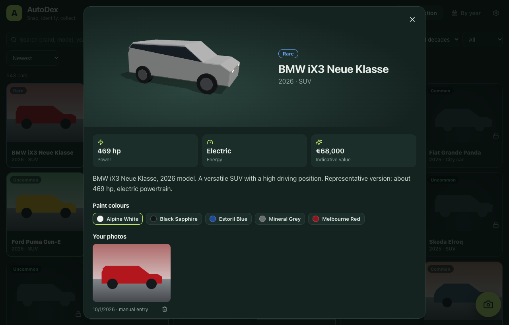
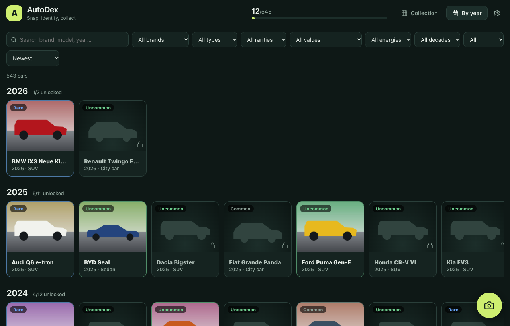

<p align="center"></p>

<h1 align="center">AutoDex</h1>

<p align="center"><b>見つけて、撮って、集める：端末内で写真を認識するクルマ収集ゲーム。</b></p>

<p align="center"> <a href="https://github.com/jeremdevgit/autodex/releases"></a> <a href="LICENSE"></a> <a href="https://github.com/jeremdevgit/autodex/actions/workflows/ci.yml"></a></p>

<p align="center"><a href="README.md">English</a> · <a href="README.fr.md">Français</a> · <a href="README.es.md">Español</a> · <a href="README.de.md">Deutsch</a> · <a href="README.it.md">Italiano</a> · <a href="README.pt.md">Português</a> · <a href="README.zh.md">简体中文</a> · <b>日本語</b></p>

<p align="center"><a href="https://github.com/jeremdevgit/autodex/releases/latest"><b>⬇ ダウンロード</b></a></p>


街で見かけたクルマを撮影すると、**端末内の AI** が車種を提案し、コレクションのカードが解放されます：**1980〜2026 年の 543 台、74 ブランド、5 段階のレア度**。アカウント不要、広告なし、クラウドなし。

<p> </p>

## 概要

| | |
|---|---|
| **カテゴリー** | 🎮 音楽とゲーム |
| **対応環境** | Windows · macOS · Linux · スマホ（Web） |
| **表示言語** | 8 言語（英・仏・西・独・伊・葡・中・日） |
| **価格** | 無料・オープンソース・広告なし・テレメトリーなし |
| **ステータス** | 安定版 |
| **ライセンス** | [GPL-3.0-or-later](LICENSE) |

## 遊び方

1. クルマを**見つけて**撮影します（画像の読み込みも可）。
2. AI が出す 5 つの候補から車種を**確定**します。196 車種を認識でき、それ以外は手動で追加できます。
3. **集める**：シルエットがあなたの写真に変わり、3D モデル、純正カラー名、出力、動力、参考価格が表示されます。
4. ブランド、ボディ、レア度、年代、年式ごとにコレクションを**コンプリート**しましょう。



## 機能

| | |
|---|---|
| 写真認識 | ResNet-50 を WebAssembly で**ローカル実行**。何もアップロードしません |
| 並べ替えとフィルター | ブランド、ボディ、レア度、価格、動力、年代、所持／未所持。「年式別」表示 |
| バックアップ | 写真を含めて 1 つの JSON に完全書き出し。読み込み時は統合または置き換え |
| スマホ ↔ パソコン | デスクトップアプリが 8 文字のペアリングコードで保護されたローカルサーバーを提供。写真単位で統合 |
| セルフホスト | `npm run build && npm run server`、または NAS 向けの `Dockerfile` |

スペックは代表的なグレードのもので、価格は目安です。

## インストール

[最新リリース](https://github.com/jeremdevgit/autodex/releases/latest)を入手してください：Windows 用 `.exe`（ユーザー単位）、macOS ユニバーサル `.dmg`、Linux 用 `.deb` と `.AppImage`。`SHA256SUMS.txt` で確認できます。インストーラーは有料証明書で署名されていません（SmartScreen が確認を求める場合があります。macOS では初回のみ右クリック › **開く**）。

**スマホ**ではインストール不要：デスクトップアプリでサーバーを起動し（*設定 › モバイルサーバー*）、同じ Wi-Fi で表示されたアドレスを開いてホーム画面に追加します。

## プライバシー

テレメトリー、アカウント、外部へのリクエストはありません：モデル、フォント、ランタイムはすべて同梱しています。写真はアプリ内に保存され、書き出しや同期をしない限り端末から出ません。同期サーバーは検証済みのデータだけを受け付け、コードを 10 回間違えたアドレスをブロックします。家庭内ネットワーク向けなので、インターネットに公開する場合は前段に HTTPS を置いてください。

## ソースからビルド

```sh
# Node.js 20+、Rust stable、Tauri の前提条件
npm ci
npm run dev              # Web 版：http://localhost:5173
npm test
npm run desktop:build    # デスクトップ用インストーラー
docker build -t autodex . && docker run -p 4174:4174 -v autodex-data:/data autodex
```

サーバーの変数：`PORT`、`HOST`、`AUTODEX_DATA_DIR`。`AUTODEX_SERVER_PORT=4174` を指定するとデスクトップアプリの起動時にサーバーも起動します。変更履歴：[CHANGELOG.md](CHANGELOG.md)。

## ライセンス

GPL-3.0-or-later — [LICENSE](LICENSE) を参照。モデルとライブラリのクレジット：[THIRD_PARTY.md](THIRD_PARTY.md)。AutoDex はどの自動車メーカーとも提携していません。ブランド名と車種名は各所有者のものです。

---

脆弱性を見つけたら、公開 Issue ではなく非公開で報告してください（[SECURITY.md](SECURITY.md) を参照）。

## jeremdevgit のその他のフリーソフトウェア

すべて無料・オープンソース・広告なし。

**🛠️ システムとハードウェア** — [Boîte à outils](https://github.com/jeremdevgit/boite-a-outils) · [rJb](https://github.com/jeremdevgit/rjb) · [LJ Hub](https://github.com/jeremdevgit/lj-hub) · [Decklight](https://github.com/jeremdevgit/decklight)

**📒 生産性とデータ** — [Carnet de notes](https://github.com/jeremdevgit/carnet-rust) · [JMeca](https://github.com/jeremdevgit/jmeca) · [Suite Libre](https://jeremdevgit.github.io/suite-libre/)

**🎮 音楽とゲーム** — [Pomme](https://github.com/jeremdevgit/pomme) · [Ludothèque](https://github.com/jeremdevgit/ludotheque) · [Batailles de France](https://github.com/jeremdevgit/batailles-de-france)
