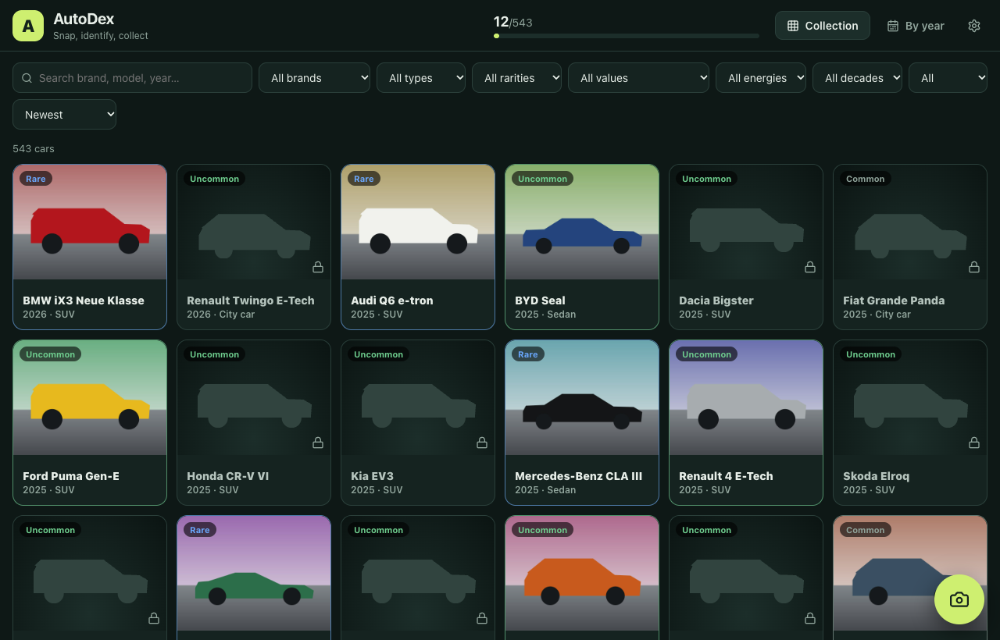
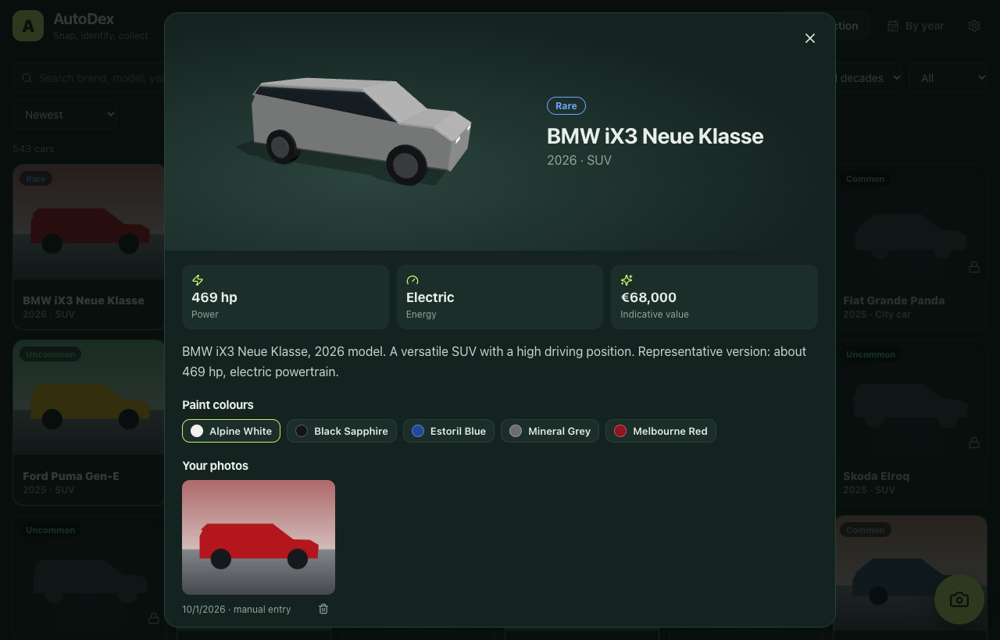
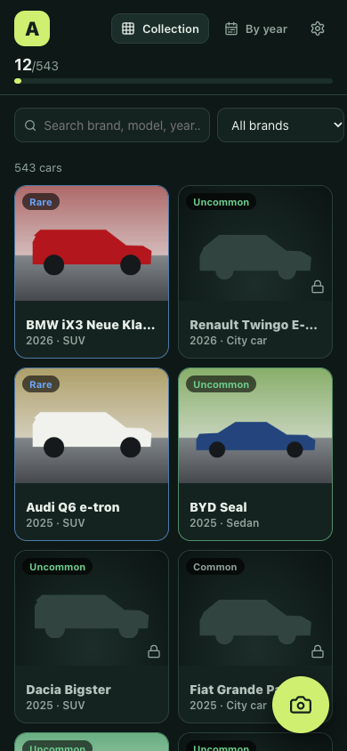
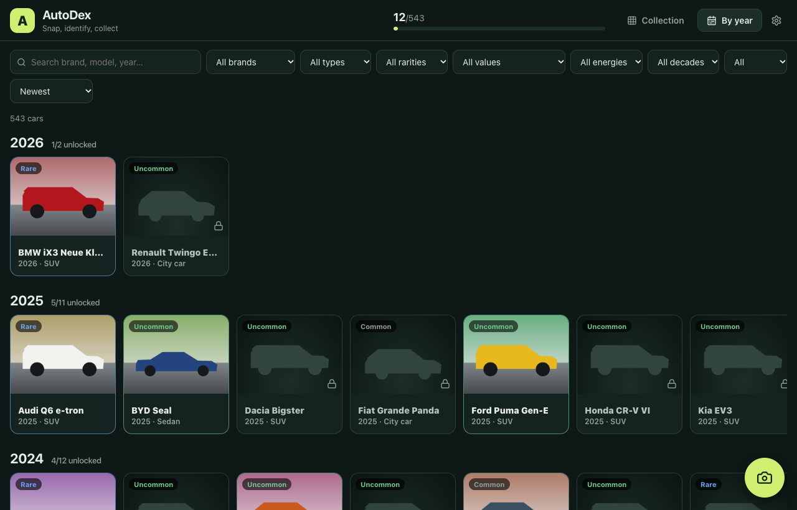

<p align="center"></p>

# AutoDex

[](https://github.com/jeremdevgit/autodex/actions/workflows/ci.yml) [](https://github.com/jeremdevgit/autodex/actions/workflows/codeql.yml) [](LICENSE) [](https://github.com/jeremdevgit/autodex/releases)

[**English**](README.md) · [Français](README.fr.md) · [Español](README.es.md)

**Spot it, snap it, collect it.** Take a photo of a car in the street, the on-device AI suggests the model, and the card is unlocked in your collection. 543 cars from 1980 to 2026, 74 brands, five rarity levels. No account, no ads, no cloud: photos stay on your devices.

## Download

Get the latest version from the [releases page](https://github.com/jeremdevgit/autodex/releases): Windows `.exe` installer (per user), macOS universal `.dmg` (Apple Silicon and Intel), Linux `.deb` and `.AppImage`. Check the files against `SHA256SUMS.txt`. The installers are not signed with a paid certificate: Windows SmartScreen may ask for confirmation, and on macOS open the app with right-click → **Open** the first time.

On a **phone**, nothing to install: start the server from the desktop app (Settings → Mobile server), then open the address it shows in your phone's browser on the same Wi-Fi. You can add it to the home screen.

## Screenshots

Demonstration data with synthetic pictures, captured from the real interface.



<p> </p>



## Features

| | |
|---|---|
| Photo recognition | ResNet-50 model running **locally** (WebAssembly, no upload). Top 5 suggestions with confidence; you confirm the right car. 196 models are recognisable, the others are added manually and marked as not AI-verified. |
| Collection | 543 cars (1980–2026): locked silhouettes until captured, then your photos, a 3D model you can rotate, real factory paint names, power, energy and indicative value. |
| Sort and filter | Brand, body type, rarity, value range, energy, decade, owned/missing; sort by year, rarity, value, power or name. "By year" view. |
| Backup | Full export to one JSON file (photos included); import by merging or replacing. |
| Phone ↔ computer sync | The desktop app includes a local server protected by an 8-character pairing code. Merge is per photo (latest change wins, deletions are kept). |
| Self-hosting | `npm run build && npm run server` or the `Dockerfile` for a NAS. |
| Languages | Français, English, Español, Deutsch, Italiano, Português, 简体中文, 日本語. |

Specs are those of a representative version and values are indicative; they vary with trim, market and condition.

## Build from source

Requirements: Node.js 20+, Rust stable and the [Tauri prerequisites](https://tauri.app/start/prerequisites/) for your system.

```sh
npm ci
npm run dev            # web version on http://localhost:5173
npm test               # unit tests
npm run desktop:build  # desktop installers
```

Self-hosted server: `npm run build && npm run server` (variables `PORT`, `HOST`, `AUTODEX_DATA_DIR`). With Docker: `docker build -t autodex . && docker run -p 4174:4174 -v autodex-data:/data autodex`. The pairing code is printed at start-up and stored in the data folder. The desktop app can also start its server at launch with `AUTODEX_SERVER_PORT=4174`.

## Privacy and security

No telemetry, no account, no external request: the AI model, fonts and runtime are bundled. Photos are stored in the app (IndexedDB) and only leave the device when you export or sync them. The sync server only accepts validated data (JPEG/PNG/WebP photos, bounded sizes), blocks an address after 10 wrong codes, and is meant for a home network: do not expose it to the Internet without HTTPS in front. See [SECURITY.md](SECURITY.md).

## Project

Maintainer: [jeremdevgit](https://github.com/jeremdevgit). Licensed under GPL-3.0-or-later. Credits and licences of the model and libraries: [THIRD_PARTY.md](THIRD_PARTY.md). Changes: [CHANGELOG.md](CHANGELOG.md). AutoDex is not affiliated with any car manufacturer; brand and model names belong to their owners.

## My other software

All free, open source and ad-free — [github.com/jeremdevgit](https://github.com/jeremdevgit):

| Software | Platform | In short |
|---|---|---|
| [Boîte à outils](https://github.com/jeremdevgit/boite-a-outils) | Windows, macOS | Computer maintenance, cleanup and file search |
| [Carnet de notes](https://github.com/jeremdevgit/carnet-rust) | Windows | Encrypted notebooks and experimental sync |
| [Decklight](https://github.com/jeremdevgit/decklight) | Windows, macOS, Linux | Virtual Stream Deck with USB control |
| [JMeca](https://github.com/jeremdevgit/jmeca) | Windows, macOS, Linux | Encrypted vehicle maintenance tracker |
| [LJ Hub](https://github.com/jeremdevgit/lj-hub) | Windows, macOS, Linux | Logitech device profile manager |
| [Pomme](https://github.com/jeremdevgit/pomme) | Windows | Apple Music and local music player |
| [rJb](https://github.com/jeremdevgit/rjb) | Windows | RGB lighting control |
| [Ludothèque](https://github.com/jeremdevgit/ludotheque) | macOS | Game library and launcher |
| [Suite Libre](https://jeremdevgit.github.io/suite-libre/) | Browser | Six tools without an account |
| [Batailles de France](https://github.com/jeremdevgit/batailles-de-france) | Browser | Real-time strategy game |
