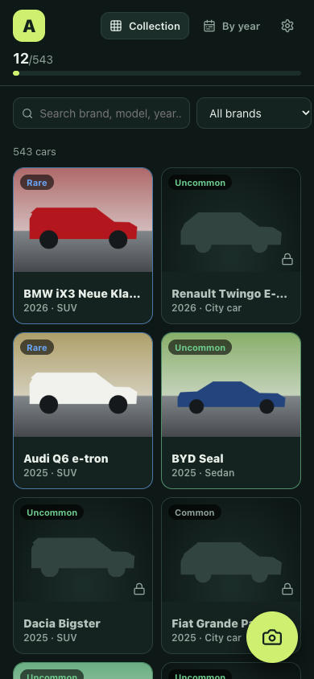

<p align="center"></p>

<h1 align="center">AutoDex</h1>

<p align="center"><b>发现、拍照、收集：本地识别照片的汽车收集游戏。</b></p>

<p align="center"> <a href="https://github.com/jeremdevgit/autodex/releases"></a> <a href="LICENSE"></a> <a href="https://github.com/jeremdevgit/autodex/actions/workflows/ci.yml"></a></p>

<p align="center"><a href="README.md">English</a> · <a href="README.fr.md">Français</a> · <a href="README.es.md">Español</a> · <a href="README.de.md">Deutsch</a> · <a href="README.it.md">Italiano</a> · <a href="README.pt.md">Português</a> · <b>简体中文</b> · <a href="README.ja.md">日本語</a></p>

<p align="center"><a href="https://github.com/jeremdevgit/autodex/releases/latest"><b>⬇ 下载</b></a></p>


在街上拍下一辆车，**设备上的 AI** 会识别车型，卡片随即在你的收藏中解锁：**1980–2026 年的 543 款车、74 个品牌、五个稀有度等级**。无需账号、没有广告、不用云端。

<p> </p>

## 概览

| | |
|---|---|
| **类别** | 🎮 音乐与游戏 |
| **平台** | Windows · macOS · Linux · 手机（网页） |
| **界面语言** | 8 种语言（英、法、西、德、意、葡、中、日） |
| **价格** | 免费、开源、无广告、无遥测 |
| **状态** | 稳定版 |
| **许可证** | [GPL-3.0-or-later](LICENSE) |

## 玩法

1. **发现**一辆车并拍照（或导入图片）。
2. 从 AI 给出的 5 个候选中**确认**车型——可识别 196 款车型，其余可手动添加。
3. **收集**：剪影变成你的照片，并附带 3D 模型、原厂车漆名称、功率、能源类型和参考价值。
4. 按品牌、车身、稀有度、年代或年份**集齐**收藏。


## 功能

| | |
|---|---|
| 照片识别 | ResNet-50 以 WebAssembly **在本地**运行，不上传任何内容 |
| 排序与筛选 | 品牌、车身、稀有度、价值、能源、年代、已拥有/未拥有；“按年份”视图 |
| 备份 | 完整导出为一个 JSON 文件（含照片）；导入时可合并或替换 |
| 手机 ↔ 电脑 | 桌面应用内置本地服务器，使用 8 位配对码保护；逐张照片合并 |
| 自托管 | `npm run build && npm run server`，或用 `Dockerfile` 部署到 NAS |

参数对应一个代表性版本，价值仅供参考。

## 安装

下载[最新版本](https://github.com/jeremdevgit/autodex/releases/latest)：Windows `.exe`（按用户安装）、macOS 通用 `.dmg`、Linux `.deb` 和 `.AppImage`；请用 `SHA256SUMS.txt` 校验。安装程序未使用付费证书签名（SmartScreen 可能要求确认；macOS 首次请右键 › **打开**）。

**手机上**无需安装：在桌面应用中启动服务器（*设置 › 移动服务器*），在同一 Wi-Fi 下打开显示的地址，并添加到主屏幕。

## 隐私

无遥测、无账号、无外部请求：模型、字体和运行时均已内置。照片保存在应用内，只有在你导出或同步时才会离开设备。同步服务器只接受经过校验的数据，同一地址输错 10 次配对码即被封禁，且仅适用于家庭网络——如需暴露到互联网，请在前面加 HTTPS。

## 从源码构建

```sh
# Node.js 20+、Rust stable 以及 Tauri 前置依赖
npm ci
npm run dev              # 网页版：http://localhost:5173
npm test
npm run desktop:build    # 桌面安装程序
docker build -t autodex . && docker run -p 4174:4174 -v autodex-data:/data autodex
```

服务器变量：`PORT`、`HOST`、`AUTODEX_DATA_DIR`；设置 `AUTODEX_SERVER_PORT=4174` 可让桌面应用启动时同时启动服务器。更新日志：[CHANGELOG.md](CHANGELOG.md)。

## 许可证

GPL-3.0-or-later，见 [LICENSE](LICENSE)。模型与库的致谢：[THIRD_PARTY.md](THIRD_PARTY.md)。AutoDex 与任何汽车制造商均无关联；品牌和车型名称归其所有者。

---

发现安全漏洞？请私下报告（见 [SECURITY.md](SECURITY.md)），不要发公开 issue。

## jeremdevgit 的其他自由软件

全部免费、开源、无广告。

**🛠️ 系统与硬件** — [Boîte à outils](https://github.com/jeremdevgit/boite-a-outils) · [rJb](https://github.com/jeremdevgit/rjb) · [LJ Hub](https://github.com/jeremdevgit/lj-hub) · [Decklight](https://github.com/jeremdevgit/decklight)

**📒 效率与数据** — [Carnet de notes](https://github.com/jeremdevgit/carnet-rust) · [JMeca](https://github.com/jeremdevgit/jmeca) · [Suite Libre](https://jeremdevgit.github.io/suite-libre/)

**🎮 音乐与游戏** — [Pomme](https://github.com/jeremdevgit/pomme) · [Ludothèque](https://github.com/jeremdevgit/ludotheque) · [Batailles de France](https://github.com/jeremdevgit/batailles-de-france)
